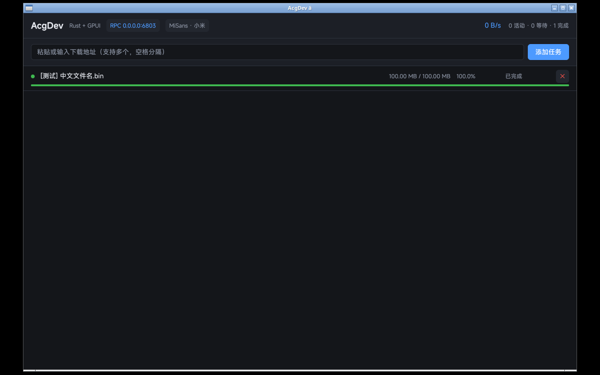

# AcgDev — Rust + GPUI 重构版

AcgDev HTTP Downloader v0.05（.NET 10 WinForms）的 Rust 重写。核心目标是修掉原版
在数据完整性上的缺陷，同时保持 aria2 生态兼容。



## 结构

```
crates/core/     下载引擎（无 UI 依赖，可独立 cargo test）
  ├─ range.rs      区间集合：区间树 + 空洞合并
  ├─ writer.rs     位置写入：pwrite 语义 + 预分配
  ├─ resume.rs     续传元数据（ETag/Last-Modified 校验）
  ├─ probe.rs      远端探测：HEAD → Range 回退、文件名推导
  ├─ task.rs       单任务状态机（单流 / 多线程两条路径）
  ├─ manager.rs    调度 + 事件广播
  └─ rpc/          aria2 JSON-RPC（HTTP + WebSocket 通知）
crates/app/      GPUI 界面（500ms 拉取快照，与引擎只共享 Arc<Manager>）
  ├─ ui/app.rs      主界面：筛选 / 批量操作 / 任务卡片 / 弹窗层
  ├─ ui/dialog.rs   新建任务、高级设置、确认框、Toast 的状态与解析
  ├─ ui/widgets.rs  纯视觉构件（进度条、分片图、徽标、按钮、输入框）
  ├─ ui/theme.rs    配色与 rgba 混色辅助
  └─ assets/fonts/ 内嵌 MiSans 子集（见该目录 README）
tools/
  ├─ subset_fonts.py      MiSans 子集化 + name 表修正
  ├─ make_icon.py         生成 assets/icon.ico
  ├─ build-windows.sh     Windows exe 一键构建（交叉编译）
  ├─ gen_gpui_shaders.sh  补齐 gpui 缺失的 DXBC 着色器常量
  ├─ patch_icu_import.py  PE 导入名 icuuc.dll → icu.dll
  └─ fxc2-shim.sh         用 wine 跑 fxc2.exe 的包装
```

## 字体

界面字体是**内嵌的 MiSans 子集**，不依赖系统字体 —— Windows / macOS / Linux
三端行高、字宽、标点宽度一致，进度条与表格列不会错位。

| 项 | 值 |
|---|---|
| 字符集 | ASCII + Latin-1/Ext-A + GB2312（6763 汉字）+ CJK 标点 + 假名 + 符号区 |
| 字重 | Regular 400 / Medium 500 / Semibold 600 / Bold 700 |
| 体积 | 30.6 MB → **6.94 MB**（22.7%） |

子集化的关键不在裁剪，而在**修正 name 表**：小米把每个字重发布成了独立家族
（`MiSans` / `MiSans Medium` / `MiSans Semibold`），weight class 又是 330/380/520
这种非标准值。fontdb 按 `(family, weight)` 检索，若不统一，`font_weight(SEMIBOLD)`
会静默落到 Regular —— 标题不加粗，且不报任何错。

细节与许可说明见 [`crates/app/assets/fonts/README.md`](crates/app/assets/fonts/README.md)。

> **许可提醒**：MiSans 采用小米自有协议，第 2 条第 2 款禁止「改编或二次开发」。
> 子集化属于该条款的灰区。若需严格合规，改用 OFL 授权的
> Noto Sans SC / 思源黑体，脚本支持 `--fonts <目录>` 直接换源。

## 相对原版修掉的问题

| 原版缺陷 | 本实现 |
|---|---|
| 写入失败被静默吞掉，进度按「已接收」而非「已落盘」计 | 写通道 ack 后才推进区间；短写抛 `ShortWrite` |
| 异常分支不归还区间 → 永久空洞 | 区间租约 RAII，drop 即归还 |
| 续传不校验 ETag，远端换文件后拼接出损坏文件 | `resume.rs` 强制指纹比对，不一致则重下 |
| 分块大小单位表 TB 写成 256 | 无此路径；分片保存未实现 |
| 配置解析 3 类未捕获异常致启动崩溃 | serde 反序列化 + 损坏元数据降级重建 |

重构过程中自己引入又被测试抓出的两个缺陷（已修）：

- `run_parallel` 直接 `open_existing` 打开 `.part`，首次多线程下载必然 ENOENT
  → 改为 `create_or_open`（e2e `range_download_is_byte_exact` 抓到）
- 未从 URL 推导默认文件名，中文名全落成 `download`
  → `probe::filename_from_url`，percent-decode + basename 防穿越

## 界面

任务卡片按三段渲染：文件名 / 状态 / 速度 → **分片进度图** → 百分比·体量·剩余·ETA·连接数·操作。

- **分片进度图**：把位图按桶聚合（默认 72 桶）画成连续细条，多连接下载时
  能直接看出哪些区段已落盘、哪些还是空洞；部分完成的桶用半透明区分。
- **详情面板**（点「详情」展开）除了 GID / 地址 / 保存位置，还把位图还原成
  **具体的字节区间**：

  ```
  分片        100 片 × 1.00 MB（已完成 74 片）
  已完成分片  0 B–74.00 MB
  待下载分片  74.00 MB–100.00 MB
  ```

  相邻分片会合并成区间，超出 4 段折叠为「… 另 N 段」。
  解码函数 `piece_done` / `done_segments` / `pending_segments` / `fmt_segments`
  刻意与编码器 `build_bitfield` 同放在 `crates/core/src/task.rs`，
  避免"编码在 core、解码在 UI"导致两边的高位在前位序约定漂移。
- **高级设置**（工具栏）：默认下载目录 / 默认连接数 / 最小分片大小 /
  User-Agent / Referer / 自定义请求头（每行一条 `Name: Value`）。
  留空的项表示不覆盖内置默认值，只作用于之后新建的任务。
  解析失败会就地报错，不会静默写入。

速度显示用**滑动窗口**采样（`SPEED_WINDOW = 5s`）。原先算"相邻两次采样的增量"，
而进度是成批落盘的（一次 commit 可能 10 MB），于是多数采样秒增量为 0、速度恒为 0、
ETA 永远是「—」；改成取窗口首尾差值后速度平滑，ETA 才有意义。

## 测试

```bash
cargo test -p acgdev-core          # 53 单元 + 8 端到端
cargo test -p acgdev --test fonts  # 5 项字体回归
```

端到端测试自带 HTTP 服务（支持 Range / 不支持 Range / ETag 变更三种服务端行为），
校验下载结果逐字节一致。

## 运行

```bash
cargo run -p acgdev -- --dir ~/Downloads --rpc-port 6800
```

参数：`--dir` 下载目录、`--rpc-port`（0 关闭）、`--rpc-secret`、`-j` 并发数、`--headless`。

RPC 与 aria2 兼容，AriaNg / Motrix / YAAW 可直接连：

```bash
curl -X POST http://127.0.0.1:6800/jsonrpc -d '{
  "jsonrpc":"2.0","id":"1","method":"aria2.addUri",
  "params":[["https://example.com/file.bin"],{"dir":"/tmp","split":"8"}]
}'
```

## 平台依赖（Linux）

```bash
sudo apt install libxkbcommon-dev libxkbcommon-x11-dev libwayland-dev \
  libx11-xcb-dev libxcb1-dev libfontconfig1-dev libfreetype-dev \
  libssl-dev pkg-config
```

`vendor/xattr` 是 `[patch.crates-io]` 补丁：上游 xattr 0.2.3 在 Linux 上引用
`libc::ENOATTR`，而 libc ≥ 0.2.18x 已把该常量限定到 BSD/Apple（Linux 用
`ENODATA`，取值相同）。gpui → gpui_http_client → zed-async-tar 会因此编译失败。

## 构建 Windows exe（在 Linux 上交叉编译）

```bash
rustup target add x86_64-pc-windows-gnu
sudo apt install gcc-mingw-w64-x86-64 binutils-mingw-w64-x86-64 wine64
./tools/build-windows.sh          # → dist/AcgDev-0.1.0-win64.exe
```

产物是单文件 GUI 程序：静态链接 libgcc，只依赖系统 DLL
（d3d11 / dcomp / dwrite / icu / dwmapi / ws2_32 等），无需 MSVC 运行库。

这条链路有三个坑，脚本里都已处理，这里记下原因以免日后重踩：

| 现象 | 原因 | 处理 |
|---|---|---|
| `couldn't read .../shaders_bytes.rs` | gpui 的 `build.rs` 用 `#[cfg(target_os = "windows")]` 判平台，而 build script 跑在 **host**（Linux）上，着色器预编译整段被跳过 | `tools/gen_gpui_shaders.sh` 用 wine 跑 fxc2 补齐 16 个 DXBC 常量 |
| `Failed to find fxc.exe` | Windows SDK 的 HLSL 编译器只有 Windows 版 | `tools/fxc2.exe`（vkd3d-shader 封装的 fxc 兼容 CLI）+ `tools/fxc2-shim.sh` |
| 启动即 `icuuc.dll not found` | gpui 依赖的 windows 0.61 在 Globalization 模块里写的是 `icuuc.dll`，Windows 系统只有 `icu.dll` | `tools/patch_icu_import.py` 就地改写 PE 导入名（等长，不动节表） |
| 启动即 `无法定位程序输入点 TaskDialogIndirect` | 同一个 host cfg 问题把 gpui 的 `RT_MANIFEST` 也挡掉了；没有 comctl32 v6 声明，加载器绑定 system32 的 v5，而该导出只在 v6 | `assets/app.manifest` + `assets/app.rc` 自行嵌入；并关掉 gpui 的 `windows-manifest` feature 防止 Windows 主机上双 manifest |
| 启动即"应用程序的并行配置不正确" | manifest 里 comctl32 v6 的 `publicKeyToken` 写错（写成 `…ccf175`）。WinSxS 按完整标识找程序集，token 错一位就是"找不到从属程序集" | 用 `assets/app.manifest` 里的 `6595b64144ccf1df`（与 `WinSxS\Manifests` 目录名一致）；`tools/build-win64.sh` 末尾会校验该值并拒绝错误 token 残留 |
| 同上，但报"第 0 行 无效的 Xml 语法" | 把 manifest 转成 UTF-16LE 再嵌入。资源是原样字节流，加载器只认 UTF-8（带 BOM 也不行） | manifest 保持 UTF-8 |

后两个在 wine 里测不出来：wine 的 comctl32 不分版本、DLL 缺失也只是加载失败不报"入口点"。
这两个问题只有在真 Windows 上才会暴露，改动后必须真机验证。

`tools/fxc2.exe` 不随仓库分发，取自 <https://github.com/MichaelMoroz/FXC2>
（vkd3d-shader + 补丁，产出标准 DXBC；只需在构建机上有）。
也可以在 Windows 主机上直接 `cargo build --release`，此时用系统 fxc.exe，无需上述任何步骤。

